<h3><code>sushant@github ~ $ whoami</code></h3>

<table>
  <tr>
    <td valign="top"></td>
    <td valign="top"></td>
  </tr>
</table>

---

### 👋 Hi, I'm Sushant Feria

I'm a **Computer Science Engineering undergraduate at Bennett University**, passionate about software engineering, problem-solving, and building scalable applications.

Currently exploring **Backend Development, Distributed Systems, and Full Stack Development**, while strengthening my foundations in Data Structures & Algorithms.

### 💻 About Me

- 🎓 B.Tech Computer Science student at Bennett University.
- 💼 Former AI Intern at **IIT Jammu**.
- 🧩 Solved **500+ problems on LeetCode**.
- ⚙️ Interested in Backend Engineering, System Design, and Distributed Systems.
- 🚀 Building projects focused on scalability, performance, and real-world problem-solving.

### 🌱 Currently Focusing On

- Data Structures & Algorithms
- Full Stack Development
- Low-Level and High-Level System Design
- Distributed Systems and Backend Engineering

### 🌐 Socials

### 🛠️ Tech Stack

**Languages**

**Frontend**

**Backend & Databases**

**Tools & Cloud**

### 🚀 Featured Projects

- **[TrafficShield – Distributed Flow Control Gateway](https://github.com/sushant-1212/distributed-rate-limiter)**  
  Distributed rate limiting, hierarchical token leasing, adaptive concurrency control, and real-time observability.

- **[LRU Cache Proxy](https://github.com/sushant-1212/lru-cache-proxy)**  
  High-performance caching proxy with LRU/LFU eviction, HTTP caching, and Singleflight request coalescing.

### 🧩 Coding Profiles

- **[LeetCode](https://leetcode.com/u/sushant_1818/)** – 500+ Problems Solved | Contest Rating: 1639
- **[GitHub](https://github.com/sushant-1212)** – Projects and contributions

---

**Always learning. Always building. Always improving. 🚀**

<!-- Proudly created with GPRM ( https://gprm.itsvg.in ) -->
